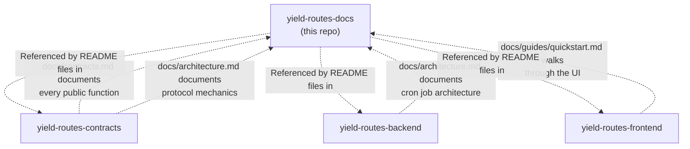

# 📚 yield-routes-docs

> **The Knowledge Base: Architecture Deep-Dives and Technical Reference for YieldRoutes**

**Comprehensive technical documentation explaining the "why" and "how" behind YieldRoutes** — this repo is the stable home for architectural decisions, protocol mechanics, integration guides, and system design patterns that would otherwise be buried in code comments or lost in issue discussions.

This repo is one of five interconnected components in the YieldRoutes ecosystem. For the complete system architecture and how these documents relate to actual implementations, see the [organization homepage](https://github.com/YOUR_ORG).

[](#whats-in-here)
[](#diagrams-index)
[](#reading-guides)
[](LICENSE)

---

**📖 Quick Navigation:** [What's In Here](#whats-in-here) • [Reading Guides](#reading-guides) • [Document Overview](#document-overview-table) • [How to Use These Docs](#how-to-use-these-docs) • [Contributing](#contributing-to-documentation)

---

## Table of Contents

- [Relationship to the Other Repos](#relationship-to-the-other-repos)
- [What's in Here](#whats-in-here)
- [Document Overview Table](#document-overview-table)
- [Reading Guides](#reading-guides)
  - [For Smart Contract Developers](#for-smart-contract-developers)
  - [For Backend/API Developers](#for-backendapi-developers)
  - [For Frontend/Integration Developers](#for-frontendintegration-developers)
  - [For Protocol Researchers](#for-protocol-researchers)
  - [For End Users and Investors](#for-end-users-and-investors)
- [How to Use These Docs](#how-to-use-these-docs)
- [Documentation Philosophy](#documentation-philosophy)
- [Diagrams Index](#diagrams-index)
- [Cross-References and Navigation](#cross-references-and-navigation)
- [Contributing to Documentation](#contributing-to-documentation)
  - [Documentation Style Guide](#documentation-style-guide)
  - [Proposing Documentation Changes](#proposing-documentation-changes)
  - [Building and Previewing Locally](#building-and-previewing-locally)
  - [Review Process](#review-process)
- [Documentation Maintenance](#documentation-maintenance)
  - [Keeping Docs in Sync with Code](#keeping-docs-in-sync-with-code)
  - [Version Control Strategy](#version-control-strategy)
  - [Archiving and Deprecation](#archiving-and-deprecation)
- [FAQ](#faq)
- [License](#license)

## Relationship to the other repos



This repo is intentionally a **documentation follower, not a source of truth**. The hierarchy is:

1. **Code is truth**: If `docs/contracts.md` and `yield-routes-contracts/src/lib.rs` ever disagree, the code is correct.
2. **Docs track code**: Documentation PRs that touch function signatures should link the corresponding contracts/backend PR.
3. **Docs explain "why"**: This repo exists to capture architectural decisions, design trade-offs, and system mechanics that aren't obvious from reading code alone.

**Key principle**: Documentation that duplicates what's already clear from well-written code creates maintenance burden. This repo focuses on the non-obvious: *why we made certain choices*, *how subsystems interact*, and *what trade-offs we accepted*.

## What's in here

This repository contains four main types of documentation:

1. **Architecture Documents** — Deep technical explanations of protocol mechanics, algorithms, and system design
2. **Contract Reference** — Complete function-level API documentation for all Soroban contracts
3. **Integration Guides** — Step-by-step tutorials for developers building on YieldRoutes
4. **Project Documentation** — Grant applications, technical specifications, and historical context

All documents are written in Markdown with embedded Mermaid diagrams for maximum portability and version control integration.

## Document Overview Table

| Document | Type | Reading Time | Target Audience | Key Takeaways |
|---|---|---|---|---|
| [`docs/architecture.md`](docs/architecture.md) | Architecture | 60-90 min | Smart contract devs, protocol researchers | Route aggregation math, vault share-price mechanics, fee distribution cycle, TWAP calculation, cron job architecture — the complete "how the numbers work" reference |
| [`docs/contracts.md`](docs/contracts.md) | API Reference | 45-60 min | Contract integrators, backend devs | Full function-level reference for all four Soroban contracts with parameters, return types, errors, and gas costs. Also summarized in [`yield-routes-contracts/README.md`](https://github.com/YOUR_ORG/yield-routes-contracts#contract-interfaces) |
| [`docs/guides/quickstart.md`](docs/guides/quickstart.md) | Tutorial | 30-45 min | New contributors, full-stack devs | End-to-end local setup walkthrough spanning all four code repos — database, backend API, frontend UI, and contract deployment |
| [`docs/grantfox-application.md`](docs/grantfox-application.md) | Grant Application | 15-20 min | Ecosystem stakeholders, investors | GrantFox funding program application with milestones and deliverables. For broader ecosystem contribution narrative, see the [org homepage](https://github.com/YOUR_ORG/.github/blob/main/profile/README.md#why-this-matters-for-stellar) |

**Total estimated reading time for complete understanding**: 4-6 hours

## Reading Guides

Choose your path based on what you're trying to accomplish:

### For Smart Contract Developers

**Goal**: Understand contract architecture, integrate with YieldRoutes contracts, or contribute new contracts

**Reading path**:
1. Start with [org homepage](https://github.com/YOUR_ORG) (15 min) — high-level system architecture
2. Read [`docs/architecture.md`](docs/architecture.md) **sections 1-3** (30 min) — protocol mechanics
3. Read [`docs/contracts.md`](docs/contracts.md) (45 min) — complete API reference
4. Review [`yield-routes-contracts/README.md`](https://github.com/YOUR_ORG/yield-routes-contracts) (20 min) — implementation guides and code examples
5. Try [`docs/guides/quickstart.md`](docs/guides/quickstart.md) **contract deployment section** (15 min) — hands-on deployment

**Prerequisites**: Rust, Soroban SDK basics, understanding of AMMs and vaults  
**Time estimate**: 2 hours  
**Next steps**: Clone `yield-routes-contracts`, run tests, try deploying to testnet

### For Backend/API Developers

**Goal**: Understand the indexer, cron jobs, and API design, or contribute backend features

**Reading path**:
1. Start with [org homepage](https://github.com/YOUR_ORG) (15 min) — system architecture
2. Read [`docs/architecture.md`](docs/architecture.md) **section 4** (20 min) — cron job architecture
3. Skim [`docs/contracts.md`](docs/contracts.md) **events section** (10 min) — what the indexer listens for
4. Read [`yield-routes-backend/README.md`](https://github.com/YOUR_ORG/yield-routes-backend) (30 min) — API reference, database schema
5. Try [`docs/guides/quickstart.md`](docs/guides/quickstart.md) **backend setup section** (20 min) — run the indexer and API locally

**Prerequisites**: Node.js/TypeScript, PostgreSQL, REST API design, basic Stellar knowledge  
**Time estimate**: 1.5 hours  
**Next steps**: Clone `yield-routes-backend`, configure `.env`, run database migrations

### For Frontend/Integration Developers

**Goal**: Build a UI that interacts with YieldRoutes, or integrate swap/vault functionality into an existing dapp

**Reading path**:
1. Start with [org homepage](https://github.com/YOUR_ORG) (15 min) — what YieldRoutes offers
2. Skim [`docs/architecture.md`](docs/architecture.md) **sections 1-2** (15 min) — enough to understand routes and vaults
3. Read [`yield-routes-frontend/README.md`](https://github.com/YOUR_ORG/yield-routes-frontend) (30 min) — component architecture, Freighter wallet integration
4. Read [`yield-routes-backend/README.md`](https://github.com/YOUR_ORG/yield-routes-backend) **API reference** (20 min) — REST endpoints you'll call
5. Try [`docs/guides/quickstart.md`](docs/guides/quickstart.md) **frontend setup** (15 min) — run the UI locally

**Prerequisites**: React, TypeScript, wallet integration experience (MetaMask/Freighter), REST APIs  
**Time estimate**: 1.5 hours  
**Next steps**: Clone `yield-routes-frontend`, explore `/app/swap` and `/app/vault` pages

### For Protocol Researchers

**Goal**: Understand design trade-offs, security properties, and compare YieldRoutes to other DeFi protocols

**Reading path**:
1. Read [org homepage](https://github.com/YOUR_ORG) **"Why This Matters"** section (10 min) — problem statement and context
2. Read [`docs/architecture.md`](docs/architecture.md) **complete** (90 min) — all protocol mechanics in depth
3. Read [`docs/contracts.md`](docs/contracts.md) **security considerations** (20 min) — attack vectors and mitigations
4. Review [`yield-routes-contracts/README.md`](https://github.com/YOUR_ORG/yield-routes-contracts) **Architecture and Design Decisions** (15 min) — why we made certain choices

**Prerequisites**: DeFi protocol knowledge (Uniswap, Yearn, Balancer), MEV awareness, economic security  
**Time estimate**: 2.5 hours  
**Next steps**: Review open Wave issues for unresolved design questions, join Discord for technical discussions

### For End Users and Investors

**Goal**: Understand what YieldRoutes does, how it works, and whether it's safe to use

**Reading path**:
1. Start with [org homepage](https://github.com/YOUR_ORG) **complete** (20 min) — high-level overview, value proposition
2. Read [`docs/architecture.md`](docs/architecture.md) **sections 1-2 only** (20 min) — how routing and vaults work (skip technical details)
3. Review [org homepage](https://github.com/YOUR_ORG) **Security and Audits** (5 min) — audit status and responsible disclosure
4. Try the [live app](https://yieldroutes.example.com) (10 min) — experience the UI firsthand

**Prerequisites**: Basic understanding of cryptocurrency, DeFi concepts (swaps, liquidity pools, yield)  
**Time estimate**: 1 hour  
**Next steps**: Connect wallet to testnet and try a small swap or vault deposit

## How to Use These Docs

**If you're new to the project**:
- Start with the [organization homepage](https://github.com/YOUR_ORG) for the 10,000-foot view
- Choose a reading guide above based on your role
- Work through documents sequentially — they build on each other

**If you're debugging an issue**:
- Check the Troubleshooting sections in repo-specific READMEs first
- Consult `docs/contracts.md` for error codes and contract behavior
- Consult `docs/architecture.md` for "why does it work this way?" questions

**If you're proposing a change**:
- Read the relevant architecture section to understand existing design
- Reference specific sections in your proposal (e.g., "As documented in `docs/architecture.md` section 2.3...")
- Update documentation as part of your PR (see [Contributing](#contributing-to-documentation))

**If you're integrating YieldRoutes**:
- Read `docs/contracts.md` for contract interfaces
- Use code examples from `yield-routes-contracts/README.md`
- Test on testnet using `docs/guides/quickstart.md`

## Documentation Philosophy

This repo follows these principles:

1. **Code is the source of truth**: When docs and code conflict, code wins. Documentation should be updated to match.

2. **Explain "why", not just "what"**: 
   - ❌ Bad: "The vault uses a 24-hour harvest cycle"
   - ✅ Good: "The vault uses a 24-hour harvest cycle to batch gas costs and prevent MEV extraction via harvest timing manipulation"

3. **Show trade-offs, not just decisions**:
   - Document *why* we chose A over B
   - Acknowledge what we gave up
   - Link to issues where alternatives were discussed

4. **Prefer diagrams over walls of text**:
   - Mermaid sequence diagrams for flows
   - Mermaid graphs for architecture
   - Tables for comparisons

5. **Link aggressively**:
   - Cross-reference between documents
   - Link to code on GitHub (with line numbers)
   - Link to external resources (SEPs, academic papers)

6. **Keep it current**:
   - Mark outdated sections with "⚠️ OUTDATED" warnings
   - Archive old versions rather than deleting them
   - Date-stamp major revisions

## Diagrams Index

All diagrams in YieldRoutes documentation use Mermaid for version control and portability.

| Diagram | Location | Type | Purpose |
|---|---|---|---|
| System architecture overview | [org homepage](https://github.com/YOUR_ORG) | Graph | Shows all 5 repos and their relationships |
| Contract relationships | `yield-routes-contracts/README.md` | Graph | How 4 contracts interact with each other |
| Route execution flow | `docs/architecture.md` § 1 | Sequence | User → Router → Pools → User |
| Vault deposit & harvest | `docs/architecture.md` § 2 | Sequence | Deposit → Auto-compound → Fee distribution |
| Multi-hop routing | `docs/architecture.md` § 1 | Sequence | How 3+ pool swaps are chained |
| Oracle price submission | `docs/architecture.md` § 3 | Sequence | Reporter → Oracle → TWAP calculation |
| Fee distribution flow | `docs/architecture.md` § 2 | Graph | Protocol fees → Treasury/Vault/LPs |
| Cron job architecture | `docs/architecture.md` § 4 | Graph | Backend jobs and their triggers |
| Database schema | `yield-routes-backend/README.md` | ERD | Tables, relationships, indexes |
| Component hierarchy | `yield-routes-frontend/README.md` | Graph | React component tree |
| State management | `yield-routes-frontend/README.md` | Graph | React Query + Zustand data flow |
| User swap flow | `yield-routes-frontend/README.md` | Sequence | UI interactions for a swap |
| User vault deposit flow | `yield-routes-frontend/README.md` | Sequence | UI interactions for vault deposit |
| Soroban constraint | [org homepage](https://github.com/YOUR_ORG) | Graph | Why we can't call SDEX from contracts |
| TWAP attack comparison | [org homepage](https://github.com/YOUR_ORG) | Table | Spot vs TWAP oracle security |

**Total diagrams across all documentation**: 15+

## Cross-References and Navigation

Documents in this repo frequently reference each other and the code repos. Here's how to navigate:

**From architecture.md to...**:
- Contract implementations: See `yield-routes-contracts/contracts/<name>/src/lib.rs`
- Backend indexer: See `yield-routes-backend/src/services/stellar-service.ts`
- Frontend integration: See `yield-routes-frontend/app/<page>/page.tsx`

**From contracts.md to...**:
- Architecture rationale: See `docs/architecture.md` sections 1-3
- Implementation examples: See `yield-routes-contracts/README.md` Implementation Guides
- Testing: See `yield-routes-contracts/contracts/<name>/src/test.rs`

**From quickstart.md to...**:
- Individual repo setup: See README.md in each repo
- Deployment details: See `yield-routes-contracts/README.md` Deploy section
- Troubleshooting: See README.md Troubleshooting sections in each repo

**Glossary of terms**: See [org homepage](https://github.com/YOUR_ORG) FAQ section for definitions of:
- Route aggregation
- SEP-56 vault
- TWAP oracle
- Fee distributor
- Auto-compounding
- Virtual shares

## Contributing to Documentation

Documentation contributions are just as valuable as code contributions. We welcome:
- Clarifications and improved explanations
- New diagrams and examples
- Corrections of outdated information
- Translations (future)
- Tutorials and guides

### Documentation Style Guide

**Writing Style**:
- Use active voice: "The router executes the swap" not "The swap is executed by the router"
- Write in present tense: "The function returns..." not "The function will return..."
- Be specific: "The harvest cycle is 24 hours" not "The harvest cycle is approximately one day"
- Define acronyms on first use: "Time-Weighted Average Price (TWAP)"

**Code Examples**:
- Always test code examples before committing
- Include comments explaining non-obvious parts
- Show both the successful path and common errors
- Use realistic values, not "foo" and "bar"

**Diagrams**:
- Use Mermaid for all diagrams (renders in GitHub automatically)
- Include a text description before complex diagrams
- Use consistent styling (colors, arrow types)
- Keep diagrams focused — if it needs 20+ nodes, split it

**Links**:
- Use relative paths for internal docs: `[architecture](docs/architecture.md)`
- Use absolute GitHub URLs for code: `https://github.com/YOUR_ORG/yield-routes-contracts/blob/main/contracts/route_aggregator/src/lib.rs#L42-L56`
- Check links with `markdown-link-check` before committing

**Formatting**:
- Use `**bold**` for UI elements and important terms
- Use `code` for function names, variables, commands
- Use `> blockquotes` for important warnings
- Use tables for comparisons and structured data

### Proposing Documentation Changes

1. **Open an issue first** for major documentation work (new guides, restructuring)
   - Describe what's missing or incorrect
   - Propose the structure of your changes
   - Get feedback before writing

2. **For minor fixes**, just open a PR:
   - Typo fixes
   - Broken link repairs
   - Small clarifications

3. **Link code changes to doc updates**:
   - If your code PR changes a contract interface, update `docs/contracts.md` in the same PR
   - If your code PR changes architecture, update `docs/architecture.md`
   - Doc-only PRs should reference the code PR they're documenting

### Building and Previewing Locally

Documentation is plain Markdown, so any Markdown viewer works. For the best preview experience:

**Option 1: GitHub's Markdown preview** (simplest):
```bash
# Just push to a branch and view on GitHub — Mermaid diagrams render automatically
git checkout -b docs/my-improvements
git add docs/
git commit -m "Improve architecture.md section 2"
git push origin docs/my-improvements
# Open the branch on GitHub and click through docs/
```

**Option 2: VS Code with extensions**:
```bash
# Install Markdown Preview Enhanced extension
code --install-extension shd101wyy.markdown-preview-enhanced

# Open any .md file and press Ctrl+Shift+V (Cmd+Shift+V on Mac)
# Mermaid diagrams render inline
```

**Option 3: Grip (GitHub-flavored Markdown server)**:
```bash
pip install grip
grip docs/architecture.md
# Opens browser to http://localhost:6419 with live reload
```

**Checking links**:
```bash
npm install -g markdown-link-check
markdown-link-check docs/**/*.md
```

### Review Process

1. **Self-review checklist**:
   - [ ] All links work (internal and external)
   - [ ] Code examples are tested and correct
   - [ ] Mermaid diagrams render properly
   - [ ] Spelling and grammar are correct
   - [ ] New terms are defined or linked to glossary
   - [ ] Changes are consistent with existing style

2. **Automated checks** (run on PR):
   - Link checking
   - Markdown linting
   - Mermaid diagram validation

3. **Human review**:
   - At least one maintainer approval required
   - Technical accuracy verified by subject matter expert
   - Clarity feedback from someone unfamiliar with the topic

4. **Merge and publish**:
   - Squash commits for clean history
   - Update "Last updated" dates in changed files
   - Link documentation PR in related code PRs

## Documentation Maintenance

### Keeping Docs in Sync with Code

**Problem**: Code changes faster than documentation. How do we prevent drift?

**Solution**:

1. **Require doc updates in code PRs**:
   - CI checks for "Docs updated: [ ]" checkbox in PR template
   - Reviewers block PRs that change interfaces without doc updates

2. **Regular doc audits**:
   - Quarterly review of all docs against current code
   - Track with "doc-drift" GitHub issues
   - Assign specific sections to maintainers

3. **Automated sync checks**:
   - Script that parses `docs/contracts.md` function signatures
   - Compares against actual Rust function signatures in contracts
   - Fails CI if they mismatch

**Doc update triggers** (when you MUST update docs):
- Adding/removing a public contract function → update `docs/contracts.md`
- Changing protocol mechanics → update `docs/architecture.md`
- Changing API endpoints → update `yield-routes-backend/README.md`
- Changing environment setup → update `docs/guides/quickstart.md`

### Version Control Strategy

**Current approach**: Single `main` branch, docs track latest code.

**When we add versioning** (post-mainnet launch):
- Use Git tags: `v1.0-docs`, `v1.1-docs`
- Maintain docs for last 2 major versions
- Archive older versions in `docs/archive/v1.0/`
- Add version picker to top of each doc

**Backwards compatibility**:
- If contract interface changes are breaking, clearly mark in `docs/contracts.md`
- Keep old examples with "⚠️ Deprecated in v2.0" warnings
- Provide migration guides for major version bumps

### Archiving and Deprecation

**When to archive**:
- Feature removed from codebase
- Design decision reversed
- Old architecture no longer relevant

**How to archive**:
1. Move document to `docs/archive/<year>/`
2. Add "⚠️ ARCHIVED" banner at top
3. Add link to replacement document if any
4. Update links in other docs to point to new location
5. Don't delete — history is valuable

**Example archived doc**:
```markdown
> **⚠️ ARCHIVED (2025-01-15)**: This design was superseded by the SEP-56 vault implementation.  
> See [`docs/architecture.md` § 2](docs/architecture.md#yieldvault) for current vault architecture.

# Old Vault Design (Pre-SEP-56)
...
```


## FAQ

### General

**Q: Why does this repo exist separately from the code repos?**  
A: Documentation that lives in code repos tends to be tightly coupled to implementation details and gets buried. This repo provides a stable home for architectural "why" explanations that span multiple repos, aren't obvious from code, and need to persist even as implementations change.

**Q: Do I need to read all the docs to contribute?**  
A: No. Follow the [reading guide](#reading-guides) for your role. Most contributors only need 1-2 documents plus the relevant repo README.

**Q: How often are these docs updated?**  
A: Docs are updated in the same PR as code changes that affect interfaces or architecture. We also do quarterly audits to catch drift.

**Q: Can I contribute documentation even if I'm not a developer?**  
A: Absolutely! Clarifications, corrections, additional examples, and improved explanations are all valuable. See [Contributing to Documentation](#contributing-to-documentation).

**Q: Are there docs in other languages?**  
A: Not yet, but translations are welcome. Open an issue to propose a translation effort.

### Technical

**Q: What's the difference between `docs/architecture.md` and the repo READMEs?**  
A: READMEs are *how to use* a specific repo (setup, API reference, troubleshooting). `docs/architecture.md` is *why the system works this way* (protocol mechanics, design decisions, cross-repo flows).

**Q: Why are contract function signatures duplicated in `docs/contracts.md` and the Rust code?**  
A: `docs/contracts.md` is a human-friendly reference with explanations, gas costs, and usage examples. The Rust code is the source of truth. We keep them in sync via PR review and automated checks.

**Q: The architecture doc mentions "Wave Issues" — what are those?**  
A: Wave is a Stellar ecosystem bounty program. Some design questions are marked as open Wave issues to invite community solutions. See [org homepage](https://github.com/YOUR_ORG) Contributing section.

**Q: I found a discrepancy between docs and code. Which is correct?**  
A: Code is always correct. Please open an issue (or PR!) to fix the docs. Tag it `doc-drift`.

**Q: Can I use the diagrams in my own project/presentation?**  
A: Yes! All diagrams are Apache 2.0 licensed. Attribution appreciated but not required.

### Using These Docs

**Q: I'm building a project that integrates YieldRoutes. Where do I start?**  
A: Follow the [For Frontend/Integration Developers](#for-frontendintegration-developers) reading guide. Focus on `yield-routes-backend/README.md` (API) and `yield-routes-frontend/README.md` (wallet integration patterns).

**Q: I want to understand the TWAP oracle to assess security. Which docs should I read?**  
A: Read `docs/architecture.md` § 3 (TWAP calculation) and `yield-routes-contracts/README.md` "TWAP vs Spot Pricing" section. Also see the attack comparison table in the [org homepage](https://github.com/YOUR_ORG).

**Q: I'm writing a thesis/paper about DeFi aggregators. Can I cite YieldRoutes?**  
A: Yes! Cite the org homepage URL and the specific docs you reference. If you publish, we'd love to hear about it (link in your PR or Discord).

**Q: Do you have API docs in OpenAPI/Swagger format?**  
A: Not yet (see roadmap in `yield-routes-backend/README.md`). For now, use the API reference table in that README.

**Q: I'm confused by a specific section in `docs/architecture.md`. Where can I ask questions?**  
A: Open a GitHub Discussion in the `.github` repo, or ask in Discord #dev-questions. If the docs are unclear, that's a bug we should fix!

### Contributing

**Q: I want to add a new integration guide (e.g., "Building a Telegram bot with YieldRoutes"). Where should it go?**  
A: Create it in `docs/guides/<your-guide>.md`. Open an issue first to discuss scope and audience.

**Q: I found a typo in `docs/contracts.md`. Do I need to open an issue?**  
A: No, just open a PR directly. Typo fixes are always welcome without prior discussion.

**Q: I'm proposing a major architecture change. Should I update docs before or after code?**  
A: Write the doc changes as part of your proposal (before code). Reviewers can assess the design from the docs, then implementation matches the approved docs.

**Q: Can I add a new diagram type (not Mermaid)?**  
A: Prefer Mermaid for version control and rendering. If you need something Mermaid can't do (complex flowcharts, custom graphics), use SVG and commit the source file (Figma export, draw.io XML) alongside the SVG.

## License

This repository is licensed under the Apache License 2.0. See [LICENSE](LICENSE) for full text.

Documentation, diagrams, and examples in this repository may be freely used, modified, and distributed under the same license.

---

**Last Updated**: January 2025  
**Maintained by**: YieldRoutes Core Team  
**Questions?**: Open a [GitHub Discussion](https://github.com/YOUR_ORG/.github/discussions) or join us in [Discord](https://discord.gg/YOUR_DISCORD)
